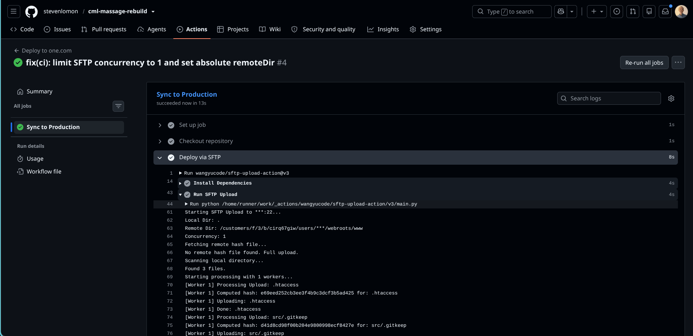

## Sep 3
  
Även med våra hemligheter satta i reopsitory:t blev det rött. Men att ändra `concurrency` till 1 och sätta den fullständiga absoluta sökvägen till remoteDir funkade för att få CI pipeline grön! Anledningen kan mycket väl vara att one.com stänger kopplingen så fort det är mer än en SFTP-anslutning i taget och med `Concurrency: 4` hade vi fyra. Viktigaste steget taget!  

Commit dbefed29adba7e07ee85085069189ccb460b6997 `ci: add paths-ignore and exclude for docs and README` var väldigt viktig. Innan den gjorde jag ändringar i `README` eller här i `working-log` och det triggade vår CI vilket pushade upp `.htaccess` till one.coms servrar vilket gjorde så att varje sub page på hela produktions sidan gav 404 haha. Men det kommer inte hända igen nu! Ändringar i `README`, `assets/` eller `docs/`, även på `main`, triggar inte igång CI nu.  

Nu finns, på tal om dokumentation, även prompten jag precis gett till Claude Code uppladdad. Jag kommer använda Claude Code! Men kommer samtidigt se till att granska all genererad kod, se till att det är från första principer, och se till att ställa frågor för att förstå det jag inte förstår. Mycket "learning as I go"!  

Det här är den enda limitation som Claude Code pekar ut nu i början:
> ### One Design Decision
> 
> The contact form on the current site submits via WordPress/WPForms. Since we're going formless PHP on shared hosting with no mail server guaranteed, I'd recommend replacing it with a mailto: link or a direct "ring/maila mig" approach — unless you want me to build a minimal PHP mail() handler. The form is lower-priority for launch since the primary conversion funnel goes through Bokadirekt anyway.  

Jag tänker att vi kör en `mailto:` länk till att börja med. En minimal `mail()` handler kan komma senare

## Sep 16
`salon.php` är en associative array! Essentially en config fil där vi har råd att använda ren php och en associative array. JSON är att föredra för services då det är nested complex och repititiv data. 
> JSON is better here because:
> 
> - It's a data format, not code — cleaner for structured catalogs
> - It can be consumed by other things if needed (a future JS frontend, a build script, an API)
> - It's easier to validate and edit when it's uniform tabular-ish data
> - If someone non-technical ever needs to update prices, JSON is less intimidating than PHP syntax

> It's a common PHP pattern for config files: cheaper than JSON (no decode step, PHP opcache caches it natively) and allows comments inline.
> Good mental model: config → PHP, catalog → JSON.